# Hi, I'm Suparn Posina 👋

Computer Science student at **San José State University** focused on building reliable software, backend systems, and AI-powered applications.

Currently seeking **Software Engineering Internship opportunities for Summer 2027.**

Interested in:
- Backend Engineering
- Artificial Intelligence & Machine Learning
- Computer Vision
- Distributed Systems
- Scalable Software Development

---

## 👨‍💻 About Me

🎓 B.S. Computer Science @ San José State University

💡 I enjoy designing software that combines strong engineering fundamentals with emerging technologies.

🔭 Currently building projects involving:
- Backend APIs
- Machine Learning applications
- Data-driven systems
- Full-stack development

🌱 Continuously improving my skills in:
- System design
- Algorithms & data structures
- Cloud technologies
- AI/ML engineering

---

## 🛠️ Technical Skills

### Languages
Java • Python • TypeScript • JavaScript • SQL • C++

### Backend & Software Engineering
- REST APIs
- Object-Oriented Programming
- Data Structures & Algorithms
- Database Design
- Software Development Practices

### AI / Machine Learning
- Machine Learning Fundamentals
- Computer Vision
- Neural Networks
- Data Processing

### Tools & Technologies
Git • GitHub • Linux • Docker • VS Code • PostgreSQL • React • Node.js

---

## 🚀 Featured Projects

### 🏠 AI Investment Property Finder

An AI-powered tool that surfaces and evaluates potential investment properties, so buyers can spend less time on spreadsheets and more time on the deals worth pursuing.

### 🎬 AI YouTube Video Scheduler & Uploader

Automates the YouTube publishing workflow: uses AI to prepare uploads and schedules videos so creators can queue content and walk away.

🔗 https://tubetimer.com

---

## 📚 Currently Learning

- Advanced Backend Architecture
- Cloud Computing
- Machine Learning Engineering
- System Design
- Large-Scale Software Development

---

## 📊 GitHub Stats

   
 
  
 
 <picture> <source media="(prefers-color-scheme: dark)" srcset="profile/snake-dark.svg" /> <source media="(prefers-color-scheme: light)" srcset="profile/snake.svg" />  </picture> 

---

## 🤝 Connect With Me

LinkedIn:
https://www.linkedin.com/in/suparnp/

GitHub:
https://github.com/oops408

---

⭐ Always interested in opportunities where I can learn from experienced engineers and contribute to impactful software.
